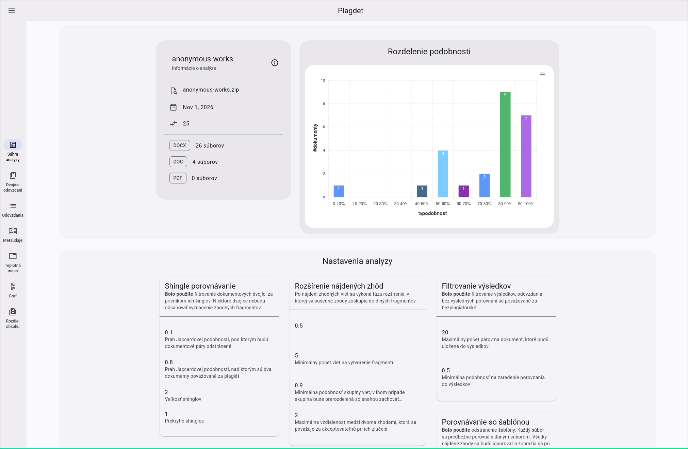
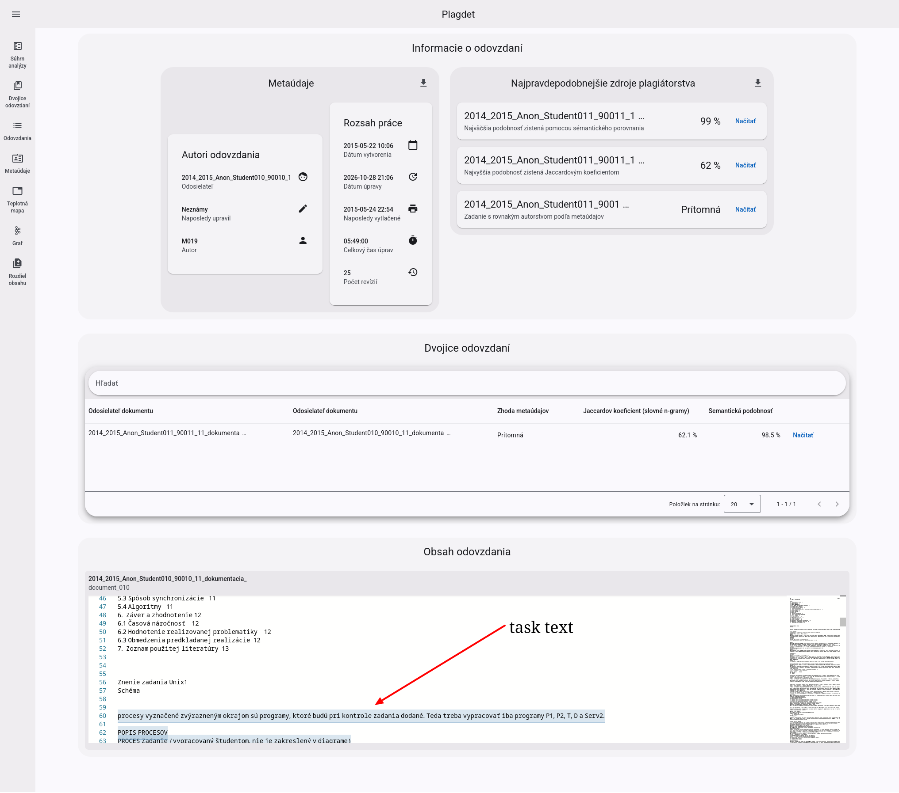
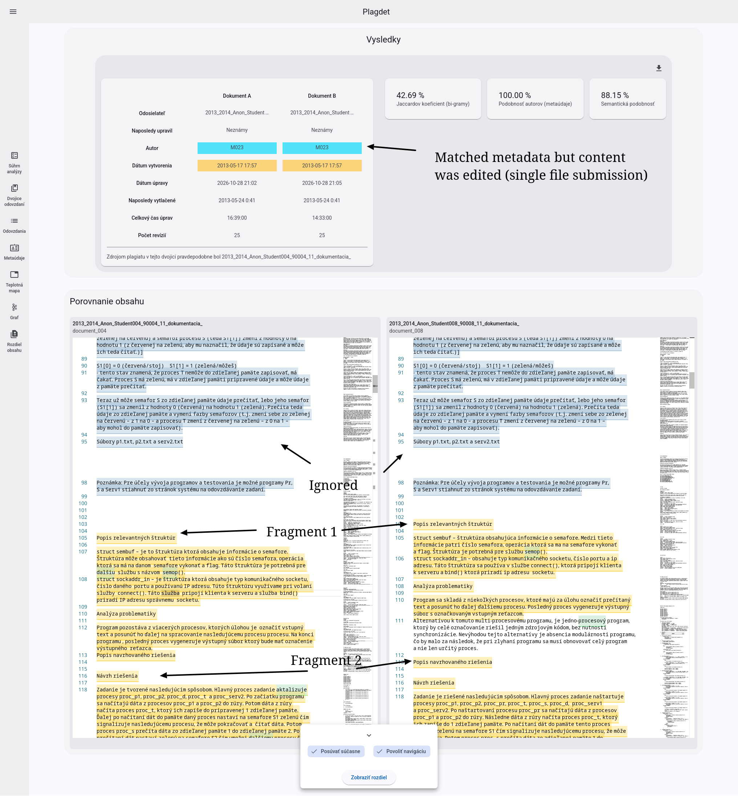
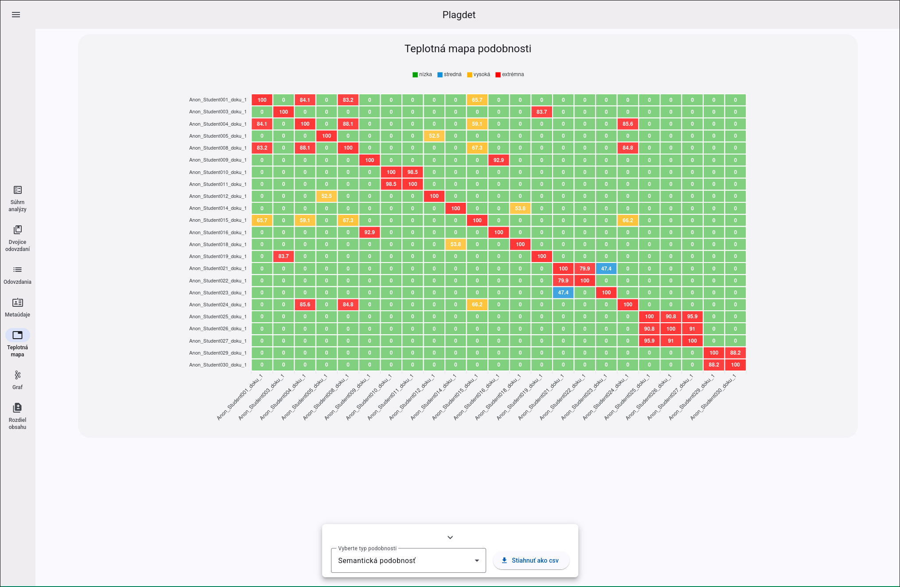
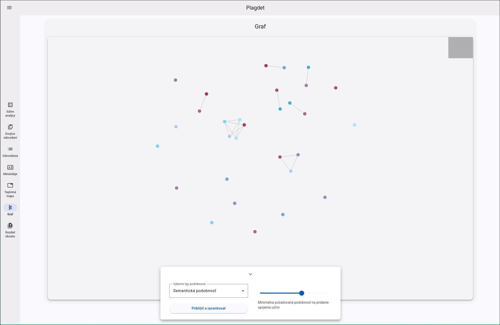

# Plagdet UI

**Plagdet UI** is an Angular-based web application for exploring and interpreting plagiarism-detection results generated by 
[Plagdet](https://github.com/TarasHamkalo/plagiarism-detection).

The application provides an interactive interface for inspecting document comparisons, navigating detected matching fragments,
examining document metadata, and exploring similarities across collections of submissions.

It uses **Angular** and **Material Design 3**, with Monaco Editor for displaying and comparing document contents.

## Approach 

Given section summarizes main functions provided by viewer.

### Analysis overview

- Summary of an analyzed document collection.
- Statistics,similarity distribution histogram and detection tool configuration.



### Submission inspection

- View the content and metadata of an individual submission.
- Inspect its most similar documents and potential plagiarism sources.
- Export submission metadata and related results to CSV.
- Highlight code fragments, task-template text, spelling issues, and other annotations.



### Document comparison

- Side-by-side document comparison with matching fragments highlighted.
- Navigation between detected matches in both documents.
- Synchronized scrolling between text editors.
- Metadata comparison, including author and modification information.
- Export comparison results to CSV.



### Similarity exploration

- **Similarity heatmap:**
  - Explore pairwise document similarity across the entire collection, with selectable 
    similarity metrics.
- **Submission graph:** 
  - Visualize relationships between submissions and identify groups of 
  related documents.
- **Cluster inspection:** 
  - Explore groups of submissions and their corresponding comparisons.
- **Content diff:** 
  - Inspect textual differences between two documents.





## Usage

The UI consumes a ZIP report generated by the Plagdet CLI.

1. Run the [Plagdet CLI](https://github.com/TarasHamkalo/plagiarism-detection) on a collection of 
  documents.
2. Obtain the generated analysis archive (by default `report.zip`).
3. Open the UI and import the archive through the **Import Analysis** page.
4. Explore the analysis using the available views.

## Development

This project was generated using [Angular CLI](https://github.com/angular/angular-cli) 
version 19.0.2.

### Install dependencies

```bash
npm install
```

### Development server

```bash
npx ng serve
```

Open `http://localhost:4200/`. The application reloads automatically when source files change.

### Production build

```bash
npx ng build
```

The production build is generated in `dist/` and can be deployed to a static web server.

### Run unit tests

```bash
npx ng test
```

### Docker deployment

The repository includes a Dockerfile using Nginx to serve the production application.

```bash
docker build -t plagdet-ui .
docker run -p 8080:80 plagdet-ui
```

The UI will be available at `http://localhost:8080`.

## Related projects and documentation

- [Plagdet CLI and detection engine](https://github.com/TarasHamkalo/plagiarism-detection)
- [Plagdet system and user documentation](docs/system-appendix-and-manual.pdf)
 
Also more information about approach decision and evaluation is present in theses text, available
at [Slovak Central Register of Theses (CRZP)](https://opac.crzp.sk/?fn=detailBiblioForm&sid=9EB7DDC054CB7EBFE473D9EAFF98).
